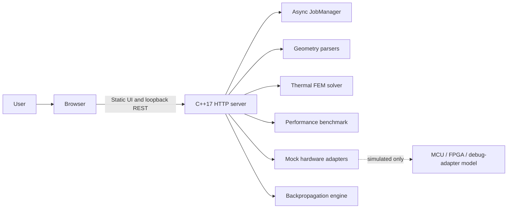

# ENGINEX — Unified Engineering Simulation & Analysis Platform
### Application: ENGINEX Workbench
**PASS Science Works R&D Internship 2026–2027 Evaluation Project**

[](https://microsoft.com)
[](https://isocpp.org)
[](https://nextjs.org)
[](https://cmake.org)
---

> A local engineering workbench bringing geometry inspection, numerical simulation, performance measurement, embedded-device mocks, and neural-network training together in one interface.

## On this page

- [Project overview](#project-overview)
- [Engineering modules](#engineering-modules)
- [Run the packaged application](#run-the-packaged-application)
- [Build from source](#build-from-source)
- [Architecture](#architecture)
- [API overview](#api-overview)
- [Validation and limitations](#validation-and-limitations)
- [Project files](#project-files)
- [Submission documentation](#submission-documentation)

## Project overview

**ENGINEX Workbench** is a Windows-oriented engineering simulation and analysis application. Its statically exported Next.js interface communicates with a C++17 REST backend over a local loopback connection. The backend includes asynchronous job handling for longer-running thermal and performance work.

The hardware module is a **software simulation** using mock adapters. It does not connect to physical hardware. Likewise, the bundled nodal-temperature CSV is synthetic sample data, not an ANSYS result.

## Engineering modules

| Module | Route | What it demonstrates |
|---|---|---|
| Geometry & data inspection | `/geometry` | ASCII STL parsing, mesh bounds, and a 3D temperature point cloud loaded from a nodal CSV. The sample CSV follows `node_id,x_m,y_m,z_m,temperature_C`. |
| Thermal analysis | `/thermal` | A 1D steady-state linear-element FEM solution for a uniformly heated rod, compared with its analytical solution and mesh-convergence study. Example meshes use 10, 20, 40, and 80 elements. Requests are bounded to 1,000 elements per mesh and 16 meshes per study. |
| Performance | `/performance` | Reproducible serial and parallel batches across 1–4 workers, with speedup, efficiency, and numerical-agreement reporting. |
| Hardware workbench | `/hardware` | Mock MCU, FPGA, and debug-adapter discovery, telemetry, simulated timeout, and recovery state. Proposed hardware wiring is not physically verified. |
| Backpropagation | `/backpropagation` | Single-sample regression, analytical gradients, central finite-difference checks, and 100 training steps. |

## Run the packaged application

The release archive is [`dist/CandidateID_Workbench.zip`](dist/CandidateID_Workbench.zip). It is a runtime bundle, not a source-code submission.

1. Extract the archive to a folder on a Windows x64 computer.
2. Run `Launch.exe`.
3. The launcher starts the bundled backend on loopback, waits for `/api/v1/health`, and opens the Workbench in the default browser.
4. Follow the launcher console's exit instruction when finished.

The packaged frontend does not require Node.js or Python at runtime. A separate clean Windows 11, no-admin, and offline-machine validation **has not been performed**; these are intended deployment conditions, not verified compatibility claims. Backend process shutdown on a clean machine has not been independently verified.

## Build from source

### Prerequisites
- **Operating System:** Windows 11 x64
- **C++ Compiler:** GCC 13+ (MinGW-w64) or MSVC 2022 (with C++17 support)
- **Build System:** CMake 3.20+ and Ninja
- **Node.js:** Use a version supported by the installed Next.js version (currently declared as Next.js 16.x; Node.js 18 is not a suitable minimum).
- **Git:** 2.30+

### C++ backend and tests

```powershell
cmake -B build -G "Ninja" -DCMAKE_BUILD_TYPE=Release
cmake --build build --config Release
ctest --test-dir build --output-on-failure
```

### Frontend static export

```powershell
cd frontend
npm ci
npm run build
npm run typecheck
npm run lint
```

The production frontend export is written to `frontend/out/`.

## Architecture

The frontend is served by the local C++ backend; the browser does not need a separate frontend development server when using the packaged release.



### Source layout
```
Enginex/
├── backend/                     # ISO C++17 domain engines and local REST server
│   ├── include/workbench/       # Public header interfaces
│   │   ├── core/                # Result<T>, JobManager, ThreadPool
│   │   ├── geometry/            # StlParser, CsvParser
│   │   ├── thermal/             # Solver1D, MeshStudy
│   │   ├── performance/         # BatchGenerator, BenchmarkHarness
│   │   ├── hardware/            # IDeviceAdapter, MockAdapters
│   │   ├── neural/              # BackpropCore
│   │   └── api/                 # HttpServer, RestRoutes
│   └── src/                     # C++17 implementation files
├── frontend/                    # Next.js App Router + TypeScript + Tailwind UI
│   ├── app/                     # 5 routed views: geometry, thermal, performance, hardware, backpropagation
│   └── components/              # Three.js 3D viewers, SVG charts, status cards
├── data/                        # Sample STL geometry and synthetic nodal-temperature CSV
├── tests/                       # Unit, integration, and negative test fixtures
├── results/                     # Exported CSV results; interactive plots are in the frontend
├── docs/                        # Architecture, RTM, Risk Register, 15-day plan, AI log, Report
├── packaging/                   # Win32 Launch.exe source, bundling scripts
└── CMakeLists.txt               # Root multi-target build configuration
```

---

## API overview

All routes use the `/api/v1` prefix.

| Purpose | Endpoint(s) |
|---|---|
| Health | `GET /health` |
| Geometry import | `POST /geometry/stl/inspect`, `POST /geometry/temperature/import` |
| Thermal solve | `POST /thermal/solve` |
| Asynchronous thermal job | `POST /thermal/jobs` |
| Performance run | `POST /performance/run` |
| Asynchronous benchmark job | `POST /performance/jobs` |
| Job status, result, cancellation | `GET /jobs/{id}`, `GET /jobs/{id}/result`, `POST /jobs/{id}/cancel` |
| Hardware simulation | `GET /hardware/devices`, `POST /hardware/{id}/connect`, `POST /hardware/{id}/disconnect`, `GET /hardware/{id}/telemetry` |
| Backpropagation training | `POST /neural/train` |

## Validation and limitations

The latest recorded CTest run reports **9 passed, 0 failed**. The project regression summary also reports successful frontend typecheck, lint, and build; thermal mesh checks and invalid-request handling; asynchronous thermal and benchmark jobs; hardware mock operations; backpropagation and finite-difference gradient checks; and cancellation/error handling.

Stored numeric evidence includes:

| Evidence | Recorded result | Artifact |
|---|---|---|
| Thermal mesh convergence | Midpoint errors of 1.25, 0.3125, 0.078125, and 0.01953125 °C for 10, 20, 40, and 80 elements | [`results/csv/thermal_convergence.csv`](results/csv/thermal_convergence.csv) |
| Parallel numerical agreement | Recorded maximum serial/parallel discrepancy is 0 °C for 1–4 workers | [`results/benchmarks/benchmark_results.csv`](results/benchmarks/benchmark_results.csv) |
| Backpropagation training | 101 recorded steps; higher-precision reference output is available | [`results/csv/backpropagation_training.csv`](results/csv/backpropagation_training.csv), [`docs/reference/backpropagation_training_100_steps.csv`](docs/reference/backpropagation_training_100_steps.csv) |

These results were not all rerun while editing this README. See [`results/README.md`](results/README.md) for evidence provenance and gaps. No clean Windows 11/offline-machine test is claimed.

## Project files

- [`backend/`](backend/): C++ engines, asynchronous job management, and HTTP API.
- [`frontend/`](frontend/): Next.js UI and 3D/plot components.
- [`data/`](data/): Sample geometry and synthetic temperature data.
- [`tests/`](tests/): C++ test suites and fixtures.
- [`packaging/`](packaging/): Windows launcher and release packaging scripts.
- [`docs/`](docs/): Architecture, design decisions, AI-use record, ownership/provenance, and report materials.
## Submission documentation

- [`docs/ai-use-log.md`](docs/ai-use-log.md): AI assistance disclosure and verification log.
- [`docs/ownership-statement.md`](docs/ownership-statement.md): Ownership, attribution, and data provenance.
- [`docs/architecture/embedded-system-design.md`](docs/architecture/embedded-system-design.md): Embedded design proposal and verification limitations.
- [`results/README.md`](results/README.md): Results and evidence index.

The handwritten derivation scan and six-page technical report PDF are pending as separate submission materials. Compare the requirements matrix with the official assignment before submission.
