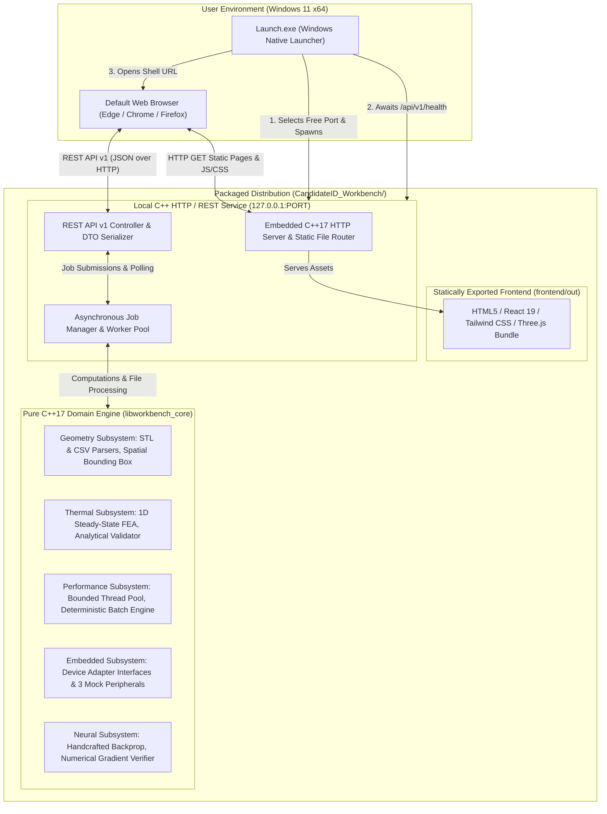

# System Architecture & Technical Design Specification
## ENGINEX — Unified Engineering Simulation & Analysis Platform (ENGINEX Workbench)

### 1. Executive Summary & Design Principles
ENGINEX Workbench is a unified, high-performance engineering simulation, analysis, and hardware-integration workbench. It is designed around three strict architectural tenets:
1. **Framework-Independent C++17 Core:** All numerical solvers (FEA, gradient descent), data parsers (STL, CSV), concurrency primitives, and hardware mocks are implemented in ISO C++17 with zero dependencies on web or UI frameworks.
2. **Unified Single-Origin Web Interface:** A modern Next.js + React + TypeScript + Tailwind CSS dashboard is statically compiled (`output: 'export'`) and directly served by the local C++ HTTP engine over loopback (`127.0.0.1`), eliminating Cross-Origin Resource Sharing (CORS) complexity and obviating the need for Node.js at end-user runtime.
3. **Turnkey Windows Deployment (design target):** The application is packaged for local use through `Launch.exe`, which manages port selection, backend startup, and browser launch. Separate clean-machine, no-admin, offline, and shutdown verification must not be inferred from this architecture description.

---

### 2. Architectural Block Diagram

---

### 3. Layered Component Architecture

#### Layer 1: Core Domain Engine (`backend/include/workbench/` & `backend/src/`)
The domain engine is organized into clean, isolated modules without circular dependencies:

* **Core (`core/`):**
  * `Result<T>`: Monadic error-handling type to represent success or structured failure codes without throwing unhandled exceptions across module boundaries.
  * `JobManager`: Thread-safe job state machine (`QUEUED`, `RUNNING`, `COMPLETED`, `CANCELLED`, `FAILED`), providing progress reporting ($0.0 \dots 1.0$), non-blocking polling, cooperative cancellation flags, and in-memory result retention for the process lifetime.
  * `ThreadPool`: Bounded worker queue with fixed hardware threads, condition-variable dispatch, and deterministic task ID preservation.

* **Geometry Subsystem (`geometry/`):**
  * `StlParser`: High-speed ASCII STL parser validating `solid`, `facet normal`, `outer loop`, `vertex`, and `endsolid` syntax. Checks for finite IEEE-754 coordinates, complete 3-vertex polygons, positive triangle counts, and computes min/max spatial bounding coordinates.
  * `CsvParser`: Parses the documented nodal-temperature schema `node_id,x_m,y_m,z_m,temperature_C`, with numeric/finite-value checks and duplicate-ID handling. Do not treat this project parser as a claim of full RFC 4180 compliance.

* **Thermal Subsystem (`thermal/`):**
  * `Solver1D`: 1D steady-state heat conduction finite element solver with uniform heat generation:
    $$-\frac{d}{dx}\left(k A \frac{dT}{dx}\right) = q A$$
    * Input parameters: $L = 1\text{ m}, A = 10^{-4}\text{ m}^2, k = 10\text{ W/(m}\cdot\text{K)}, q = 10{,}000\text{ W/m}^3, T(0) = 100^\circ\text{C}, T(L) = 20^\circ\text{C}$.
    * Discretization: $N$ uniform linear 2-node elements with element length $h = L/N$.
    * Element stiffness matrix:
      $$\mathbf{K}^{(e)} = \frac{k A}{h} \begin{bmatrix} 1 & -1 \\ -1 & 1 \end{bmatrix}$$
    * Consistent element load vector:
      $$\mathbf{F}^{(e)} = \frac{q A h}{2} \begin{bmatrix} 1 \\ 1 \end{bmatrix}$$
    * Global assembly with Dirichlet boundary condition elimination (modifying RHS accordingly).
    * Analytical solution validation:
      $$T_{\text{exact}}(x) = 100 - 80\frac{x}{L} + \frac{q}{2k}x(L-x)$$
    * Mesh study evaluating $N \in \{10, 20, 40, 80\}$, evaluating FE interpolation at element midpoints:
      $$T_{\text{FE}}(x_{\text{mid}, e}) = \frac{T_e + T_{e+1}}{2}$$
      and computing $e_{\text{mid}} = |T_{\text{FE}}(x_{\text{mid}}) - T_{\text{exact}}(x_{\text{mid}})|$.

* **Performance Subsystem (`performance/`):**
  * `BatchGenerator`: Seeded pseudo-random generation of test cases with variations in $k \in [1, 100]\text{ W/(m}\cdot\text{K)}$ and $q \in [1000, 50000]\text{ W/m}^3$.
  * `BenchmarkHarness`: Measures wall-clock execution time across worker counts $p \in \{1, 2, 3, 4\}$ (capped at logical cores). Executes 1 warm-up run + 5 timed repetitions per worker count using `std::chrono::steady_clock`. Calculates:
    $$\text{Speedup } S_p = \frac{T_1}{T_p}, \quad \text{Efficiency } E_p = \frac{S_p}{p}$$
  * `AgreementVerifier`: Validates that serial and parallel results match identically within numerical precision:
    $$\max_i |T_{\text{serial}, i} - T_{\text{parallel}, i}| \le 10^{-8\ \circ}\text{C}$$

* **Embedded Hardware Subsystem (`hardware/`):**
  * `IDeviceAdapter`: Abstract pure virtual C++ interface declaring:
    * `DeviceIdentity identify() const`
    * `DeviceCapabilities capabilities() const`
    * `Result<void> connect()`
    * `Result<void> disconnect()`
    * `Result<TelemetryMessage> readTelemetry()`
  * Three concrete mock adapters represent an MCU, FPGA, and debug-adapter role. They are simulations, not physical transports. Any proposed STM32F401RE, iCE40UP5K, SWD/JTAG, UART, or SPI wiring is subject to the limitations in `embedded-system-design.md`; no board-level mapping is verified.
  * State recovery & fault injection: Configurable simulated timeout on connect/telemetry allowing demonstration of clear UI error badges and graceful retry recovery. All telemetry is strictly flagged `is_simulated = true`.

* **Neural Subsystem (`neural/`):**
  * `BackpropCore`: Single-sample regression training step:
    $$x = 1,\ y = 2,\ h = \tanh(wx + b),\ \hat{y} = vh + c,\ J = \frac{1}{2}(\hat{y} - y)^2$$
    * Initial values: $w = 0.5,\ b = 0,\ v = 1,\ c = 0,\ \eta = 0.1$.
    * Forward pass values: $wx+b = 0.5 \implies h = \tanh(0.5) \approx 0.46211716, \hat{y} \approx 0.46211716, e = \hat{y} - y \approx -1.53788284, J \approx 1.18254182$.
    * Analytical gradients:
      $$\frac{\partial J}{\partial c} = e,\quad \frac{\partial J}{\partial v} = e \cdot h,\quad \frac{\partial J}{\partial b} = e \cdot v \cdot (1 - h^2),\quad \frac{\partial J}{\partial w} = e \cdot v \cdot (1 - h^2) \cdot x$$
    * Central finite differences gradient verification:
      $$\left|\frac{\partial J}{\partial \theta}_{\text{analytical}} - \frac{J(\theta + \epsilon) - J(\theta - \epsilon)}{2\epsilon}\right| \le 10^{-5} \quad (\epsilon = 10^{-6})$$
    * 100-step training loop with parameter history and loss curve generation.

---

#### Layer 2: API Transport & Web Server (`backend/src/api/`)
* **Transport Protocol:** HTTP 1.1 REST with JSON payload formatting.
* **Network Binding:** Strictly bound to loopback `127.0.0.1`. Never binds to `0.0.0.0` or public network adapters.
* **Endpoints:**
  * `GET /api/v1/health`: System readiness, version, uptime, hardware capabilities.
  * `POST /api/v1/geometry/stl/inspect`: ASCII STL upload/inspection, triangle count, bounding box.
  * `POST /api/v1/geometry/temperature/import`: ANSYS temperature CSV parse and point statistics.
  * `POST /api/v1/thermal/jobs`: Submit a validated asynchronous 1D FEA mesh study.
  * `POST /api/v1/thermal/solve`: Synchronous thermal solve endpoint.
  * `GET /api/v1/jobs/{id}`: Asynchronous job polling (progress, state, status message).
  * `GET /api/v1/jobs/{id}/result`: Retrieve a completed job result.
  * `POST /api/v1/jobs/{id}/cancel`: Cooperative job cancellation request.
  * `POST /api/v1/performance/run`: Execute serial vs multicore benchmark suite.
  * `GET /api/v1/hardware/devices`: Enumerate mock devices and status.
  * `POST /api/v1/hardware/{id}/connect`: Connect to selected mock device.
  * `POST /api/v1/hardware/{id}/disconnect`: Disconnect mock device.
  * `GET /api/v1/hardware/{id}/telemetry`: Poll telemetry packet (supports simulated timeout test).
  * `POST /api/v1/neural/train`: Execute analytical gradients, finite-difference checks, and 100-step training.

---

#### Layer 3: Frontend Client (`frontend/`)
* Built with Next.js App Router, React 19, TypeScript, Tailwind CSS, Lucide-react icons, and Three.js.
* Statically exported (`npm run build` -> `frontend/out/`).
* Five dedicated engineering views:
  1. `/geometry`: STL 3D viewport with OrbitControls, triangle summary, CSV import toggle, 3D point cloud temperature visualizer, interactive node inspection tooltip.
  2. `/thermal`: Rod parameter controls, FEA mesh study trigger, temperature distribution plot, analytical comparison overlay, midpoint error table, convergence rate, CSV download.
  3. `/performance`: Workload settings (cases, mesh size, seed), thread count selector, live progress, speedup & efficiency charts, serial/parallel temperature agreement verification ($\le 10^{-8\ \circ}\text{C}$), system hardware manifest.
  4. `/hardware`: 3 simulated device cards (Microcontroller, FPGA, JTAG), connection toggles, capability manifests, real-time telemetry readout, simulated failure & retry demonstration badge.
  5. `/backpropagation`: Forward equation cards, analytical gradient derivations, finite differences check verification table, 100-step loss curve, handwritten working sheet reference.

---

#### Layer 4: Packaging and Desktop Integration (`packaging/`)
* **Launcher (`packaging/windows/Launch.exe`):**
  * Written in native C++ using Win32 API (`ws2_32.lib`, `shell32.lib`).
  * Binds a temporary socket to `127.0.0.1:0` to acquire a guaranteed free ephemeral port from the OS kernel.
  * Spawns `backend_server.exe --port <PORT> --web-root <FRONTEND_DIR>` as a tracked child process assigned to a Windows Job Object configured with `JOB_OBJECT_LIMIT_KILL_ON_JOB_CLOSE`.
  * Polls `http://127.0.0.1:<PORT>/api/v1/health` until HTTP 200 is confirmed.
  * Invokes `ShellExecuteW(..., L"open", url, ...)` to launch the user's default browser.
  * Awaits termination or signals clean shutdown, ensuring no orphaned processes remain.
