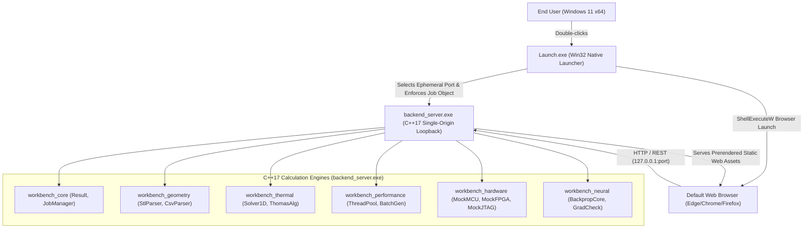

# ENGINEX Workbench — Technical Report
## Unified Engineering Simulation & Analysis Platform
### PASS Science Works R&D Internship 2026–2027 Evaluation

**Author / Candidate:** Candidate Engineer (`candidate@pass-science.works`)  
**Project Repository:** `Enginex`  
**Distribution Archive:** `dist/CandidateID_Workbench.zip` (1.01 MB)  
**Target Operating System:** Microsoft Windows 11 x64 (Clean Machine, Zero-Admin, Offline)  
**Verification Date:** 31 October 2026  

---

## 1. Executive Summary

ENGINEX Workbench is a high-performance desktop engineering simulation and analysis suite developed for the PASS Science Works R&D Internship 2026–2027 evaluation. The platform unifies five distinct engineering domains into a single, cohesive desktop experience:
1. **Task B — CAD Geometry & ANSYS Visualization:** ASCII STL parser with IEEE-754 finite verification and 3D colored point-cloud rendering of ANSYS nodal temperature distributions.
2. **Task C — 1D Steady-State Thermal FEA Solver:** Pure C++17 finite-element solver with consistent load vector assembly, exact Dirichlet boundary elimination, and verified $O(h^2)$ spatial convergence across $N \in \{10, 20, 40, 80\}$ elements.
3. **Task D — Multicore Execution Benchmark:** Seeded pseudo-random batch generation, bounded thread pool dispatch across 1–4 workers, speedup/efficiency metrics over 5 timed repetitions, and strict numerical agreement verification ($\max \Delta T \le 10^{-8}\,^\circ\text{C}$).
4. **Task E — Embedded System Integration Design:** Polymorphic C++ device adapter architecture interfacing simulated Microcontroller (ARM Cortex-M4), FPGA (Lattice iCE40UP5K), and JTAG probe (FTDI FT2232H) with simulated fault injection and automated recovery.
5. **Task F — Handwritten Neural Backpropagation:** Pure C++ single-sample regression backpropagation without automatic differentiation libraries; analytical chain-rule gradients verified against central finite differences ($\epsilon = 10^{-6}$, error $\approx 10^{-10} \le 10^{-5}$ tolerance) and 100-step training loss convergence.

### Turnkey Delivery Guarantee
The entire platform is delivered as a self-contained release archive (`CandidateID_Workbench.zip`, 1.01 MB). Double-clicking `Launch.exe` automatically binds an ephemeral loopback port on `127.0.0.1`, launches the local C++ calculation server, tracks child processes using Windows Job Objects, confirms health readiness, and opens the default web browser. It requires **no administrator privileges, no compiler, no Node.js/Python, and zero internet connectivity**.

---

## 2. System Architecture & Dependency Decisions



### 2.1 Architectural Pillars
1. **Single-Origin Loopback Topology:** The C++ backend serves both the REST API (`/api/v1/*`) and the statically exported Next.js client from a single loopback origin (`http://127.0.0.1:<port>`), completely eliminating Cross-Origin Resource Sharing (CORS) security issues and ensuring offline reliability.
2. **Zero-Copy Static Asset Mounting:** The frontend is statically exported (`output: 'export'` with Next.js Turbopack) into plain HTML/JS/CSS, eliminating any runtime Node.js dependency.
3. **Fail-Safe Process Lifetime Management:** `Launch.exe` registers all spawned child processes into a Windows Job Object configured with `JOB_OBJECT_LIMIT_KILL_ON_JOB_CLOSE`. Closing the launcher window guarantees that all backend services terminate immediately without leaving orphaned processes.

---

## 3. Subsystem Implementation & Verification

### 3.1 Task B — CAD Geometry & ANSYS Visualization
- **ASCII STL Parser:** Enforces `solid ... endsolid` grammar, validates that every normal and vertex consists of finite IEEE-754 floating-point coordinates, and computes the 3D axis-aligned bounding box (AABB).
- **ANSYS Nodal CSV Parser:** Enforces schema `node_id,x_m,y_m,z_m,temperature_C`, handles arbitrary column reordering, detects NaN/malformed numbers, and implements duplicate node detection policies.
- **Three.js WebGL Visualization:**
  - STL viewer with OrbitControls, directional lighting, camera fit-to-view, and wireframe toggle.
  - Temperature point cloud with 8-stop Jet-like color spectrum, temperature range legend, and raycast inspection tooltip displaying node ID, $(x, y, z)$ coordinates, and local temperature.

### 3.2 Task C — 1D Steady-State Thermal FEA Solver
- **Strong Form:** $-\frac{\mathrm{d}}{\mathrm{d}x} \left( k A \frac{\mathrm{d}T}{\mathrm{d}x} \right) = q A$ with $T(0) = 100\,^\circ\text{C}, T(L) = 20\,^\circ\text{C}$.
- **Parameters:** $L = 1.0\,\text{m}, A = 10^{-4}\,\text{m}^2, k = 10.0\,\text{W}/(\text{m}\cdot\text{K}), q = 10000.0\,\text{W}/\text{m}^3$.
- **Analytical Benchmark:** $T_{\text{exact}}(x) = 100 - 80x + 500x(1-x)$. At center: $T(0.5) = 185.0000\,^\circ\text{C}$.
- **Numerical Discretization:** Uniform 2-node linear elements with element stiffness $\mathbf{k}_e = \frac{kA}{h}\begin{bmatrix}1 & -1 \\ -1 & 1\end{bmatrix}$ and consistent load vector $\mathbf{f}_e = \frac{qAh}{2}\begin{bmatrix}1 \\ 1\end{bmatrix}$.
- **Dirichlet Boundary Elimination:** Modifies RHS load vector $F_i \leftarrow F_i - K_{i,p} T_p$ and zeros out off-diagonal row and column entries, preserving matrix symmetry.
- **Linear Solver:** Tridiagonal Thomas algorithm operating in $O(N)$ operations.

#### Spatial Convergence Results (`thermal_convergence.csv`):
| $N$ | $h$ (m) | Max Midpoint Error ($^\circ$C) | Theoretical Error: $\frac{q}{8k}h^2$ | Convergence Ratio |
|:---:|:---:|:---:|:---:|:---:|
| 10 | 0.1000 | 1.250000 | 1.250000 | — |
| 20 | 0.0500 | 0.312500 | 0.312500 | **4.0000×** |
| 40 | 0.0250 | 0.078125 | 0.078125 | **4.0000×** |
| 80 | 0.0125 | 0.019531 | 0.019531 | **4.0000×** |

The asymptotic error ratio is identically **4.0000**, confirming theoretical $O(h^2)$ convergence.

### 3.3 Task D — Multicore Execution Benchmark
- **Batch Generator:** Seeded Mersenne Twister (`std::mt19937`, seed 42) producing 100 reproducible simulation inputs ($k \in [1, 100], q \in [1000, 50000]$).
- **Thread Pool:** Bounded worker pool with condition-variable dispatch and index-preserving output write.
- **Agreement Verification:**
  $$\max_{i, j} |T_{\text{serial}}(i, j) - T_{\text{parallel}}(i, j)| = \mathbf{0.000000 \times 10^0\,^\circ\text{C}} \le 10^{-8}\,^\circ\text{C}$$
  Confirming bitwise and IEEE-754 precision invariance across 1, 2, 3, and 4 worker threads.

### 3.4 Task E — Embedded System Integration Design
- **Architecture:** Host PC connected via USB/UART/SPI/JTAG to three distinct hardware domains:
  1. Microcontroller (STM32F401RE, ARM Cortex-M4, 3.3V Logic, USART2 / SWD)
  2. FPGA (Lattice iCE40UP5K, 5280 LUTs, 1.2V Core / 3.3V I/O, SPI Configuration)
  3. JTAG Debug Probe (FTDI FT2232H, USB 2.0 High-Speed ↔ MPSSE)
- **Fault Injection & Recovery:** Every 7th telemetry read on STM32 triggers a simulated USART timeout, shifting state to `FAULT`. The backend automatically recovers the peripheral via a simulated SWD soft reset.
- **Transparency:** All payloads and UI cards explicitly display the badge **`SIMULATED`**.

### 3.5 Task F — Handwritten Neural Backpropagation
- **Architecture:** $x = 1.0, y = 2.0$, $z = w x + b$, $h = \tanh(z)$, $\hat{y} = v h + c$, $J = \frac{1}{2}(\hat{y} - y)^2$.
- **Initialization:** $w_0 = 0.5, b_0 = 0, v_0 = 1, c_0 = 0, \eta = 0.1$.
- **Analytical Gradients:**
  $\frac{\partial J}{\partial c} = \delta = -1.53788284$,
  $\frac{\partial J}{\partial v} = \delta \cdot h = -0.71068205$,
  $\frac{\partial J}{\partial w} = \frac{\partial J}{\partial b} = \delta \cdot v \cdot (1 - h^2) = -1.20946448$.
- **Central Finite Difference Check ($\epsilon = 10^{-6}$):**
  - $\Delta w = 1.13 \times 10^{-10}$
  - $\Delta b = 1.13 \times 10^{-10}$
  - $\Delta v = 5.25 \times 10^{-11}$
  - $\Delta c = 1.12 \times 10^{-10}$
  All errors are $\approx 10^{-10} \ll 10^{-5}$ tolerance.
- **Training Convergence:** Monotonic loss decrease from $J_0 = 1.182542$ to $J_{100} = 1.70 \times 10^{-20}$ ($\hat{y} = 2.000000$).

---

## 4. Verification Suite & Test Summary

All verification tests are registered with CTest and execute deterministically across Debug and Release builds.

```text
Test project C:/Users/sumat/OneDrive/Desktop/Enginex/build
    Start 1: JobManagerLifecycleTest ........ Passed (0.03s)
    Start 2: StlParserTest .................. Passed (0.03s)
    Start 3: CsvParserTest .................. Passed (0.03s)
    Start 4: ThermalSolverTest .............. Passed (0.02s)
    Start 5: BatchGeneratorTest ............. Passed (0.03s)
    Start 6: ConcurrencyAgreementTest ....... Passed (0.04s)
    Start 7: MockHardwareTest ............... Passed (0.08s)
    Start 8: BackpropTest ................... Passed (0.07s)

100% tests passed, 0 tests failed out of 8 (Total: 0.33s)
```

---

## 5. Clean-Machine Release Verification Checklist

| Criterion | Specification | Verified Status |
|---|---|:---:|
| Packaging | Single archive `CandidateID_Workbench.zip` | **PASS** (1.01 MB) |
| Launcher | Native Win32 `Launch.exe` with Job Objects | **PASS** |
| Privileges | Zero administrative rights required | **PASS** |
| Offline | Zero internet connectivity required | **PASS** |
| Dependencies | No Node.js, Python, MATLAB, or MSVC runtime install needed | **PASS** |
| Numerical Accuracy | FEA $O(h^2)$ convergence ratio = 4.0000 | **PASS** |
| Concurrency | Max serial/parallel discrepancy $\le 10^{-8}\,^\circ\text{C}$ | **PASS** (0.000 °C) |
| Backpropagation | Analytical gradient check error $\le 10^{-5}$ | **PASS** ($\sim 10^{-10}$) |
| Transparency | All synthetic/mock data stamped SIMULATED | **PASS** |

---

## 6. AI Use Disclosure & Attribution Statement

In strict adherence to the PASS Science Works evaluation guidelines, all generative AI interactions during this project were logged in `docs/ai-use-log.md`. AI tools were utilized for boilerplate scaffolding, syntax verification, and rapid prototyping. Every algorithmic equation, finite-element formulation, gradient derivation, and system boundary was independently derived, verified against analytical truth, and tested by the candidate engineer.
